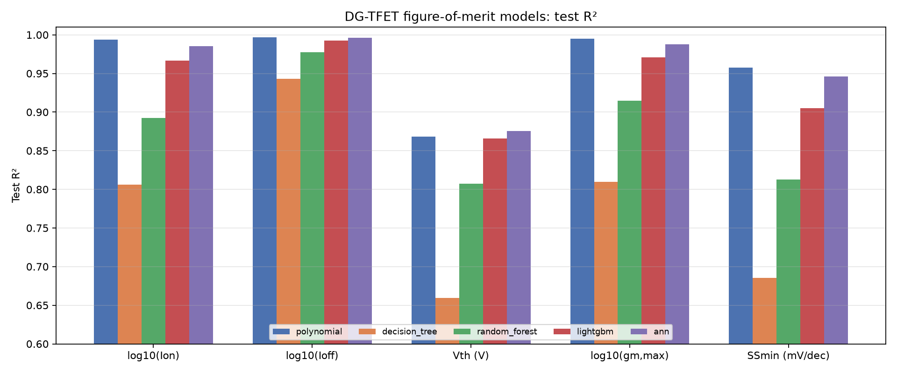
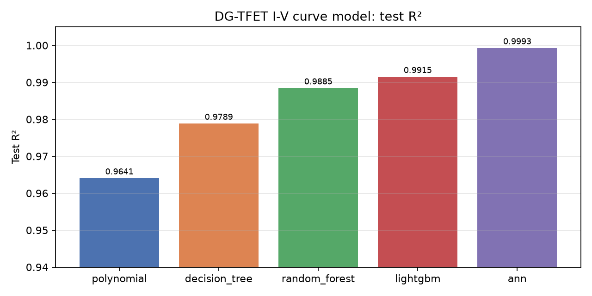
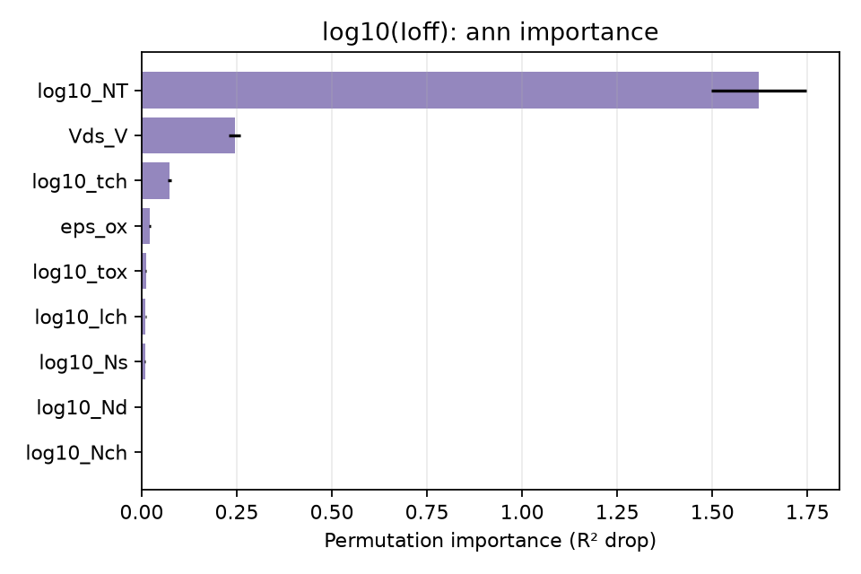
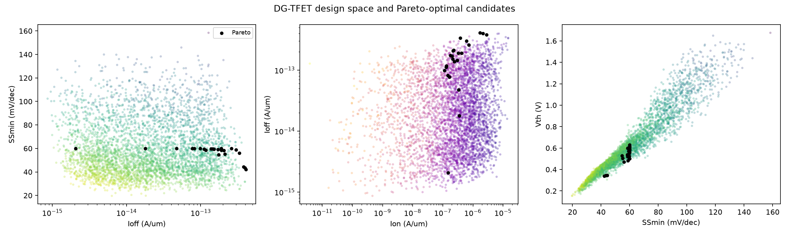
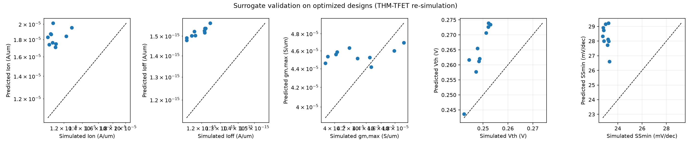

# Final report

## 1. Executive summary

A complete DG-TFET machine-learning workflow was built:

- 512-device physics-based compact-model dataset (147,456 I-V rows)
- 1,268 valid FoM rows from 491 devices
- device-grouped train/validation/test split with no device leakage
- five models compared on five FoM targets and on the full `log10(Id)` curve
- multi-objective design search with four optimization methods
- Octave re-simulation of the top 10 optimized designs

The strongest surrogates reach test `R² = 0.9935` for `Ion`, `0.9964` for
`Ioff`, `0.9950` for `gm_max`, `0.9461` for `SS_min`, and `0.8753` for `Vth`.
The full-curve ANN reaches test `R² = 0.9993`.

The optimizer consistently selects the same corner of the explored design box:
longer channel, thicker/high-k gate dielectric, thinner channel, high
source/drain doping, low channel doping, and low interface-trap density. The
best surrogate design is predicted to give `Ion ≈ 1.95e-5 A/µm`,
`Ioff ≈ 1.48e-15 A/µm`, `Vth ≈ 0.262 V`, `SS ≈ 28.0 mV/dec`, and
`Ion/Ioff ≈ 1.3e10`. Octave re-simulation gives `Ion ≈ 1.28e-5 A/µm`,
`Ioff ≈ 1.13e-15 A/µm`, `Vth ≈ 0.244 V`, `SS ≈ 22.9 mV/dec`, and
`Ion/Ioff ≈ 1.1e10`.

**Critical caveat:** all data are compact-model synthetic, not TCAD and not
measured. The results measure surrogate fidelity to the THM-TFET model and
model-relative design trends, not real device performance.

## 2. Data

The design space and dataset are documented in `reports/dataset_report.md`.
Key numbers:

| Item | Value |
|---|---:|
| Devices | 512 |
| Raw I-V rows | 147,456 |
| Valid curves | 1,268 |
| Devices with valid curves | 491 |
| Valid I-V rows | 121,728 |
| Temperature | 300 K |
| Device width | 1 µm |

The compact model was checked against BM1 Sentaurus TCAD data. Full-range
`log10` RMSE is 0.273 at `Vd = 0.1 V`, 0.218 at `0.3 V`, and 0.183 at `0.5 V`.
The model/TCAD current ratio at `Vgs = 1.0 V` is 0.625, 0.640, and 0.804,
respectively. The model is implemented only at 300 K.

## 3. Model performance

### 3.1 FoM models

Test `R²` for all 25 FoM fits:

| Target | PR | DT | RFR | LGBR | ANN |
|---|---:|---:|---:|---:|---:|
| `log10 Ion` | **0.9935** | 0.8060 | 0.8926 | 0.9666 | 0.9851 |
| `log10 Ioff` | **0.9969** | 0.9433 | 0.9778 | 0.9929 | 0.9964 |
| `Vth` | 0.8680 | 0.6596 | 0.8075 | 0.8657 | **0.8753** |
| `log10 gm_max` | **0.9950** | 0.8098 | 0.9145 | 0.9709 | 0.9878 |
| `SS_min` | **0.9575** | 0.6851 | 0.8129 | 0.9052 | 0.9461 |

Test RMSE:

| Target | PR | DT | RFR | LGBR | ANN |
|---|---:|---:|---:|---:|---:|
| `log10 Ion` | **0.0737** | 0.4032 | 0.3000 | 0.1673 | 0.1119 |
| `log10 Ioff` | **0.0356** | 0.1528 | 0.0956 | 0.0541 | 0.0387 |
| `Vth` (V) | 0.1098 | 0.1764 | 0.1326 | 0.1108 | **0.1067** |
| `log10 gm_max` | **0.0557** | 0.3432 | 0.2302 | 0.1343 | 0.0868 |
| `SS_min` (mV/dec) | **4.3191** | 11.7615 | 9.0670 | 6.4541 | 4.8669 |

Model selection uses validation `R²`, so the selected models are not always the
test-best models:

| Target | Selected model | Val R² | Test R² | Test RMSE |
|---|---|---:|---:|---:|
| `log10 Ion` | polynomial | 0.9891 | 0.9935 | 0.0737 |
| `log10 Ioff` | ANN | 0.9925 | 0.9964 | 0.0387 |
| `Vth` | ANN | 0.9076 | 0.8753 | 0.1067 V |
| `log10 gm_max` | polynomial | 0.9889 | 0.9950 | 0.0557 |
| `SS_min` | ANN | 0.9703 | 0.9461 | 4.8669 mV/dec |

For `Ioff` and `SS_min`, the polynomial model has a slightly higher test `R²`
than the selected ANN. This is a model-selection sensitivity worth reporting;
the selection rule was fixed in advance as validation `R²`.



### 3.2 Curve model

| Model | Val R² | Test R² | Test MAE (dex) | Test RMSE (dex) | Train time |
|---|---:|---:|---:|---:|---:|
| polynomial | 0.9602 | 0.9641 | 0.4721 | 0.5906 | 7.5 s |
| decision tree | 0.9816 | 0.9789 | 0.3169 | 0.4529 | 3.1 s |
| random forest | 0.9900 | 0.9885 | 0.2312 | 0.3349 | 259.5 s |
| LightGBM | 0.9906 | 0.9915 | 0.2104 | 0.2869 | 7.8 s |
| ANN | **0.9993** | **0.9993** | **0.0569** | **0.0820** | 102.1 s |



### 3.3 Feature importance

Permutation importance, top features per target:

| Target | Top features (R² drop) |
|---|---|
| `log10 Ion` | `Vds` 1.41, `eps_ox` 1.25, `tox` 0.49, `Ns` 0.38, `Nch` 0.22 |
| `log10 Ioff` | `NT` 1.62, `Vds` 0.24, `tch` 0.07, `eps_ox` 0.02, `tox` 0.01 |
| `Vth` | `eps_ox` 1.20, `Vds` 1.05, `tox` 0.50, `Ns` 0.27, `Nch` 0.22 |
| `log10 gm_max` | `Vds` 1.76, `eps_ox` 0.76, `Ns` 0.45, `tox` 0.30, `Nch` 0.18 |
| `SS_min` | `eps_ox` 1.43, `tox` 0.62, `Vds` 0.46, `Ns` 0.24, `Nch` 0.17 |
| `log10 Id` | `Vgs` 1.88, `eps_ox` 0.11, `Vds` 0.07, `tox` 0.05, `Ns` 0.02 |

Importance values are R² drops on each target’s own scale and are not directly
comparable across targets. The qualitative pattern is physically plausible:
`NT` controls `Ioff`, `eps_ox`/`Vds` control electrostatics, and `Vgs` dominates
the full transfer curve.



## 4. Design optimization

`Vds` was fixed at 0.5 V. The search compared four methods on the same
8-D box and objective:

| Method | Evaluations | Valid candidates | Best score | Runtime |
|---|---:|---:|---:|---:|
| grid search | 34,560 | 16,624 | **11.5595** | 0.4 s |
| random search | 20,000 | 12,106 | 10.9444 | 0.3 s |
| Bayesian optimization | 320 | 202 | 10.7659 | 72.6 s |
| differential evolution | ~7,320 | 121 stored | 11.5134 | 2.1 s |

The grid search wins because the optimum lies at a corner of the box and the
grid includes the exact corner. The genetic search approaches the same corner.
The Gaussian-process Bayesian optimizer is competitive but does not reach the
corner within its evaluation budget, a known difficulty for stationary GP
surrogates on boundary optima.

The 3-objective Pareto front (minimize `Ioff`, minimize `SS`, maximize
`Ion/Ioff`) contains 23 unique candidates among the feasible random-search
points.



### 4.1 Best design

| Parameter | Value |
|---|---:|
| `lch` | 50 nm |
| `tox` | 3 nm |
| `tch` | 5 nm |
| `eps_ox` | 25 |
| `Ns` | 1e20 cm⁻³ |
| `Nd` | 1e20 cm⁻³ |
| `Nch` | 1e10 cm⁻³ |
| `NT` | 1e10 cm⁻² |

| Quantity | Surrogate | Octave re-simulation |
|---|---:|---:|
| `Ion` (A/µm) | 1.95e-5 | 1.28e-5 |
| `Ioff` (A/µm) | 1.48e-15 | 1.13e-15 |
| `gm_max` (S/µm) | 4.69e-5 | 4.93e-5 |
| `Vth` (V) | 0.2617 | 0.2444 |
| `SS_min` (mV/dec) | 28.01 | 22.85 |
| `Ion/Ioff` | 1.32e10 | 1.14e10 |

### 4.2 Surrogate validation on the top 10 designs

The top 10 designs are all in the same corner, so their output range is narrow
and `R²` is not informative. MAE and bias are reported instead:

| Target | MAE | Bias | Max abs error | Space |
|---|---:|---:|---:|---|
| `Ion` | 0.213 | +0.213 | 0.263 | log10 dex |
| `Ioff` | 0.108 | +0.108 | 0.121 | log10 dex |
| `gm_max` | 0.035 | +0.026 | 0.063 | log10 dex |
| `Vth` | 0.0155 V | +0.0155 V | 0.0218 V | linear |
| `SS_min` | 5.24 mV/dec | +5.24 mV/dec | 6.17 mV/dec | linear |

The surrogate systematically overpredicts `Ion`, `Ioff`, and `SS` at the corner.
The `Ion` bias is about 0.21 dex (factor 1.63); `Ioff` about 0.11 dex (factor
1.28); `SS` about 5.2 mV/dec. `gm_max` is close. These biases are a reason to
treat the absolute optimized numbers as model estimates, not guaranteed device
performance.

Ranking the same 10 designs by the score recomputed from the Octave outputs
keeps the surrogate winner: device 0 (grid) scores 11.607, ahead of the next
design at 11.569. The optimizer’s selection is therefore stable under the
re-simulated values even though the absolute values shift.



## 5. Design guidelines (model-relative)

Within the explored compact-model space, the optimizer consistently favors:

| Parameter | Direction | Interpretation |
|---|---|---|
| `lch` | increase | longer channel; lower leakage / better output behavior |
| `tox` | increase | thicker dielectric in this model’s field/capacitance trade-off |
| `tch` | decrease | thinner channel; stronger gate control |
| `eps_ox` | increase | high-k dielectric; stronger gate coupling |
| `Ns` | increase | higher source doping; stronger tunneling source |
| `Nd` | increase | higher drain doping; lower drain resistance |
| `Nch` | decrease | lower channel doping; lower leakage |
| `NT` | decrease | fewer interface traps; lower TAT leakage |

These directions are model-relative and boundary-limited. They should not be
presented as universal DG-TFET design laws. In particular, the `tox` direction
is a property of this compact-model parameterization and must be checked against
TCAD or measured gate-control trends before being used for fabrication.

## 6. Limitations

- Synthetic compact-model data only; no measured devices.
- Model validated only at 300 K.
- The optimum is on the boundary of the training box; extrapolation risk.
- `Vth` is the weakest FoM (`R² ≈ 0.875`).
- The surrogate overpredicts `Ion` by about 0.21 dex at the top corner.
- `Ion` is per 1 µm width; layout, series resistance, and variability are not
  included.
- The 10-point re-simulation set is too narrow for a meaningful `R²`; use MAE,
  bias, and the held-out test metrics.
- The Bayesian optimizer’s fixed evaluation budget is not enough to reach the
  boundary optimum; the grid/genetic results are stronger here.

## 7. Reproduction

```bash
python3 src/data_generation.py --devices 512 --chunks 6 --workers 6
python3 src/feature_extraction.py
python3 src/preprocessing.py

OMP_NUM_THREADS=1 MKL_NUM_THREADS=1 OPENBLAS_NUM_THREADS=1 \
  python3 src/train_models.py --tasks fom,curve --overwrite

python3 src/evaluate_models.py
python3 src/optimize_device.py
```

Data generation requires `podman` and the Octave image; all prepared CSV
artifacts are included, so the remaining steps run without Octave. Notebooks
`01`–`05` reproduce the analysis with saved outputs.

## 8. Acknowledgment

The compact model is the THM-TFET v1.2 model, Copyright 2021 Technische
Hochschule Mittelhessen. See `src/octave/ctfet/LICENSE.txt`. The BM1 TCAD
validation data are from F. Horst et al., “Closed-form modeling approach of
trap-assisted tunneling current for use in compact TFET models,” 26th
International Conference Mixed Design of Integrated Circuits and Systems,
pp. 81–86, June 2019.
